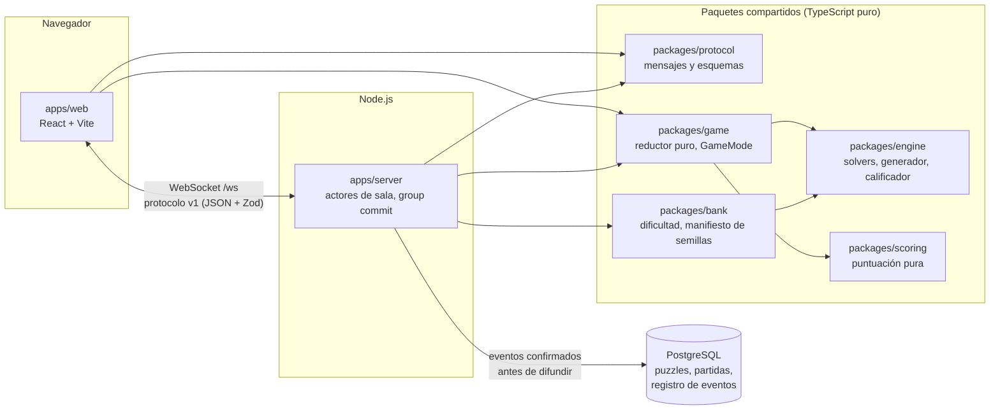

# Sudoku Killer

[English](README.md) · **Español**

Sudoku killer cooperativo en tiempo real para hasta 6 jugadores. Se entra con un código de sala y un apodo, sin cuentas.

[](https://github.com/slesgmd/sudoku-killer/actions/workflows/ci.yml)
[](LICENSE)
[](tsconfig.base.json)


- **Servidor autoritativo.** La solución nunca sale de él; un inspector de filtración revisa cada mensaje saliente en las pruebas de integración y E2E.
- **Sincronización en tiempo real** por WebSocket, con un protocolo versionado y validado con Zod en los dos extremos; cada jugada se confirma en PostgreSQL antes de difundirse.
- **Reconexión sin pérdida de estado.** Asiento, vidas, puntos y notas sobreviven a un corte (plazo de gracia de 2 minutos) y a un reinicio del servidor, que reconstruye las partidas desde el registro de eventos.
- **Pruebas a fondo:** propiedades, dos solvers independientes verificados entre sí, E2E con Playwright contra el servidor real, caos con semilla y prueba de carga.

## Capturas

| Inicio | Lobby |
|---|---|
|  |  |
| **Partida en curso** | **Resultados** |
|  |  |

<details>
<summary>Vista en el celular (390 px)</summary>


</details>

El prototipo visual se hizo con Claude Design a partir de decisiones de diseño propias, documentadas en [docs/diseno.md](docs/diseno.md).

## Arquitectura



**Una jugada, del clic a la difusión.** El jugador toca una celda y pulsa un número. El cliente la muestra como pendiente y envía un comando `cell.place` con su propio `id`. En el servidor, el mensaje pasa por el límite de velocidad y la validación con Zod, y entra en la cola del actor de la sala, que procesa un comando a la vez. El reductor puro de `packages/game` decide el resultado contra la solución, que solo tiene el servidor, y el calificador calcula el nivel de la celda para la puntuación. El hecho resultante (`cell.solved` o `cell.mistake`) recibe el siguiente `seq` de la partida y se escribe en PostgreSQL con un group commit; solo después de confirmarlo, la bandeja de salida de la sala lo difunde, en orden, a todos los jugadores. Cada cliente aplica el mismo evento con el mismo reductor y la misma limpieza de notas, así que todas las pantallas convergen. Si la conexión se corta, el cliente reenvía los comandos pendientes con el mismo `id`, y el servidor responde desde su caché de idempotencia en lugar de aplicarlos dos veces.

## Decisiones técnicas

| Problema | Decisión | Alternativa descartada | Por qué |
|---|---|---|---|
| Seis jugadores compiten por el mismo tablero y la respuesta tiene que seguir secreta. | **Servidor autoritativo** con protocolo propio sobre `ws` ([ADR 0002](docs/adr/0002-tiempo-real.md)). | Colyseus, Socket.IO. | Colyseus sincroniza un objeto de estado, que duplica el registro de eventos y facilita filtrar la solución; Socket.IO agrega un protocolo y un cliente que el juego no necesita. |
| El estado, la puntuación y la reconexión tienen que reconstruirse exactos, también tras un reinicio. | **Registro de eventos** por partida, solo de hechos y confirmado antes de difundir ([ADR 0004](docs/adr/0004-registro-de-eventos.md)). | Guardar el estado actual; escritura asíncrona. | El estado pierde la historia para depurar y recalibrar; la escritura asíncrona podría perder eventos que los clientes ya vieron. |
| Una comprobación de unicidad equivocada publicaría puzzles rotos. | **Dos solvers independientes** (propagación de restricciones con búsqueda dom/wdeg, y Dancing Links) que no pueden importarse entre sí, comparados entre ellos y con fuerza bruta ([docs/motor.md](docs/motor.md)). | Un solo solver. | Un error de un solo camino de código pasa inadvertido; que dos algoritmos distintos coincidan es una evidencia mucho más fuerte. |
| La dificultad y la puntuación tienen que reflejar lo difícil que es una celda *para una persona*. | **Calificador de técnicas humanas**: 5 niveles, de los singles a X-Wing y las combinaciones de unidad, sin adivinar nunca ([docs/motor.md](docs/motor.md), [docs/dificultad.md](docs/dificultad.md)). | Calificar por números iniciales o por el esfuerzo de búsqueda del solver. | El esfuerzo de búsqueda mide a la computadora, no al jugador; además, el calificador da un nivel a cada jugada, así que una deducción difícil vale más que un single forzado. |
| La puntuación tiene que premiar el aporte real y hacer que adivinar no convenga, antes de tener partidas reales. | **Parámetros validados con simulación Monte Carlo**, con tres tipos de bots sobre el banco completo ([docs/puntuacion.md](docs/puntuacion.md)). | Una fórmula por velocidad. | Con las mismas partidas simuladas, la fórmula por velocidad dejaba al jugador veloz ganar el 66,3 % de los duelos, frente al 57,4 % con el modelo elegido. |
| Hasta 6 personas editan a la vez las mismas notas compartidas. | **Operaciones explícitas de agregar y quitar, ordenadas por el servidor**, cliente optimista y deshacer solo si la nota no cambió ([ADR 0005](docs/adr/0005-notas-grupales.md)). | CRDT; gana la última escritura por celda; alternar. | Siempre hay un servidor central, así que un CRDT solo suma metadatos; la última escritura pisa ediciones simultáneas; dos «alternar» simultáneos se anulan sin que nadie lo vea. |

Todas las decisiones están indexadas en [docs/adr/](docs/adr/README.md).

## Pruebas y calidad

- **Pruebas de propiedades con fast-check.** Cada propiedad corre con una ayuda que imprime la semilla si falla, y cada semilla que falla queda como caso fijo de regresión; una regla de lint prohíbe llamar a `fc.assert` directamente ([docs/motor.md](docs/motor.md#pruebas-aleatorias-y-semillas)).
- **Solvers comparados.** En 1000 puzzles aleatorios por tamaño (4×4, 6×6 y 9×9), los dos solvers dan la misma cantidad de soluciones, y la misma solución en los 189 únicos. El solver de Dancing Links con poda coincidió con Dancing Links puro en los 4307 puzzles comparados. El corpus de 1000 puzzles 9×9 tiene la unicidad confirmada por los dos ([docs/motor.md](docs/motor.md#solver-b-f4c)).
- **Calificador correcto.** En el corpus, 401 109 deducciones y ninguna contra la solución. El nivel de cada jugada cuesta 9,2 ms en el p95 ([docs/motor.md](docs/motor.md#mediciones-3)).
- **Inspector de filtración.** Activo por defecto en todas las pruebas de integración y E2E: falla si un mensaje lleva la solución, una ficha, un número no revelado o las notas personales de otro jugador ([SPEC §8.3](docs/SPEC.md#83-inspector-de-filtración-t-311-t-291)). Además, cada build de producción se revisa en busca del simulador, del banco y de cualquier solución serializada.
- **E2E con Playwright** contra el servidor real: seis pestañas juegan una partida completa, seis clics simultáneos en la misma celda dan un solo acierto, un corte real no pierde nada, las páginas se recuperan solas de un reinicio del servidor y de una caída de la base sin mostrar jugadas sin confirmar, y cualquier violación de la Content-Security-Policy hace fallar la prueba ([apps/web/e2e/](apps/web/e2e/)).
- **Caos** con semilla: cierres reales del socket, una conexión que se corta justo después de enviar una jugada y antes de su respuesta, y saturación forzada; al final, cada página tiene que coincidir con el servidor y cada jugada tiene que estar una sola vez en el registro ([chaos.spec.ts](apps/web/e2e/chaos.spec.ts)).
- **Carga.** 50 salas × 6 jugadores (300 conexiones) en una instancia: latencia de una jugada de 15,3 ms en el p95 en el escenario realista y de 49,3 ms en estrés (cada conexión al ritmo del límite de 20 comandos por segundo), con un objetivo de 150 ms. Medido en un contenedor de 4 CPU con los clientes en la misma máquina, no en el hosting ([docs/carga.md](docs/carga.md)).
- **CI** ([ci.yml](.github/workflows/ci.yml)) en cada push a `main` y en cada pull request: typecheck, ESLint con información de tipos, Prettier, Vitest, build y E2E. Workflows semanales corren el corpus completo, semillas de caos nuevas y la prueba de carga.

## Limitaciones conocidas y trabajo futuro

- **El servidor gratuito se duerme** tras 15 minutos sin tráfico y tarda alrededor de un minuto en despertar; la web sigue en pie y muestra el aviso «Despertando el servidor…» ([ADR 0007](docs/adr/0007-hosting.md)).
- **La puntuación solo está calibrada con simulación.** El jugador veloz todavía gana alrededor del 57 % de los duelos contra un jugador lógico igual de rápido, y el tamaño de la penalización por error es lo primero que se recalibra con partidas reales; el registro de eventos permite recalcular las partidas pasadas sin volver a jugarlas ([docs/puntuacion.md](docs/puntuacion.md#10-limitaciones-conocidas)).
- **Una sola instancia.** Las salas vivas están en memoria detrás de la interfaz `RoomStore`; escalar exigiría un almacén compartido y afinidad por sala.
- **Las cifras de carga son locales.** Falta repetirlas en el hosting, y la saturación en una red lenta real no se probó ([docs/carga.md](docs/carga.md)).
- **Interfaz solo en español**, con cada texto detrás de una clave de i18n; todavía sin tema oscuro.
- Las ideas fuera de la v1 (modo competitivo, ranking de la sesión, chat, modo contrarreloj, identidad persistente) están en [docs/IDEAS_FUTURAS.md](docs/IDEAS_FUTURAS.md).

## Cómo correrlo en local

**Requisitos:** Node.js 24 (ver `.node-version`), pnpm 12 (Corepack) y PostgreSQL (18 en desarrollo y en la CI). Las pruebas E2E necesitan además el Chromium de Playwright.

```sh
pnpm install

# Base local: un rol sin privilegios y su propia base.
# Con la ayuda (escribe DATABASE_URL en apps/server/.env; PSQL indica la ruta de psql)…
pnpm --filter @sudoku-killer/server db:setup-local
# …o copiando apps/server/.env.example a apps/server/.env y completando DATABASE_URL.
pnpm --filter @sudoku-killer/server db:migrate
pnpm --filter @sudoku-killer/server bank:load   # regenera y verifica los 2000 puzzles (unos minutos)

pnpm dev   # servidor en 127.0.0.1:8080 y web en http://localhost:5173
```

Para probar la interfaz sin base de datos: `pnpm --filter @sudoku-killer/web dev` y abrir `http://localhost:5173/?sim=1&bot=3`, un servidor simulado en el navegador con tres bots (solo en desarrollo).

| Comando | Qué hace |
|---|---|
| `pnpm check` | Typecheck, ESLint y Prettier |
| `pnpm test` | Pruebas unitarias, de propiedades y de integración (Vitest; las del servidor usan PGlite en proceso) |
| `pnpm build` | Compila todos los paquetes y la web, y revisa el bundle |
| `pnpm e2e` | Playwright contra el servidor real (antes, `pnpm exec playwright install chromium` en `apps/web`) |
| `pnpm test:corpus` | Corpus completo: 1000 puzzles, el banco y la validación de la puntuación (unos 10 minutos) |

## Estructura

```
apps/
  server/      servidor de salas: WebSocket, actores de sala, PostgreSQL (Drizzle), banco, scripts de carga y de puntuación
  web/         cliente React, pruebas E2E, servidor simulado y bots solo para desarrollo
packages/
  engine/      motor puro del puzzle: modelo, dos solvers, generador y calificador
  protocol/    mensajes y esquemas Zod del protocolo v1 (nunca la solución)
  game/        reductor puro de la partida y módulos GameMode
  scoring/     puntuación pura y sus parámetros versionados
  bank/        equivalencia de dificultades y regeneración de semillas
docs/          especificación, ADR y documentos del motor, la puntuación, la carga, la seguridad y el diseño
design/        prototipo original de la interfaz
tests/         pruebas del repositorio (reglas de lint, configuración del despliegue)
```

## Despliegue

El juego corre en privado para un grupo cerrado: el servidor de salas en un servicio web gratuito de Render, el sitio estático en Render y PostgreSQL en Neon, todo descrito en [render.yaml](render.yaml). Cada conexión necesita la clave de acceso del grupo (el servidor solo tiene configurado su hash SHA-256); el sitio envía una CSP estricta y cabeceras de seguridad, y los respaldos semanales cifrados se comprueban con un simulacro de restauración ([ADR 0007](docs/adr/0007-hosting.md), [docs/seguridad.md](docs/seguridad.md)). Este README no enlaza a la instancia en producción.

## Documentación

La documentación de diseño de [docs/](docs/) está en español: la [especificación](docs/SPEC.md) con sus reglas verificables y casos de prueba, los [ADR](docs/adr/README.md) y los documentos del [motor](docs/motor.md), la [dificultad](docs/dificultad.md), la [puntuación](docs/puntuacion.md), la [carga](docs/carga.md), la [seguridad](docs/seguridad.md) y el [diseño](docs/diseno.md). El código, los identificadores y los mensajes de commit están en inglés.

## Licencia y autor

[MIT](LICENSE) © 2026 Sebastián Lescano · [github.com/slesgmd](https://github.com/slesgmd)
