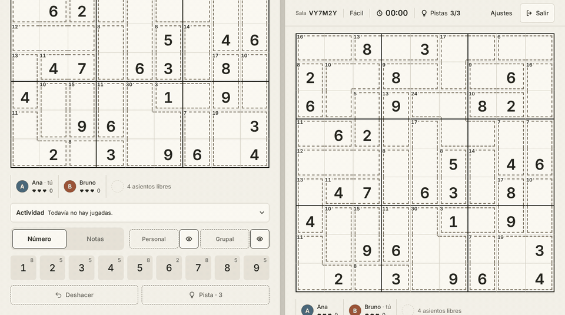
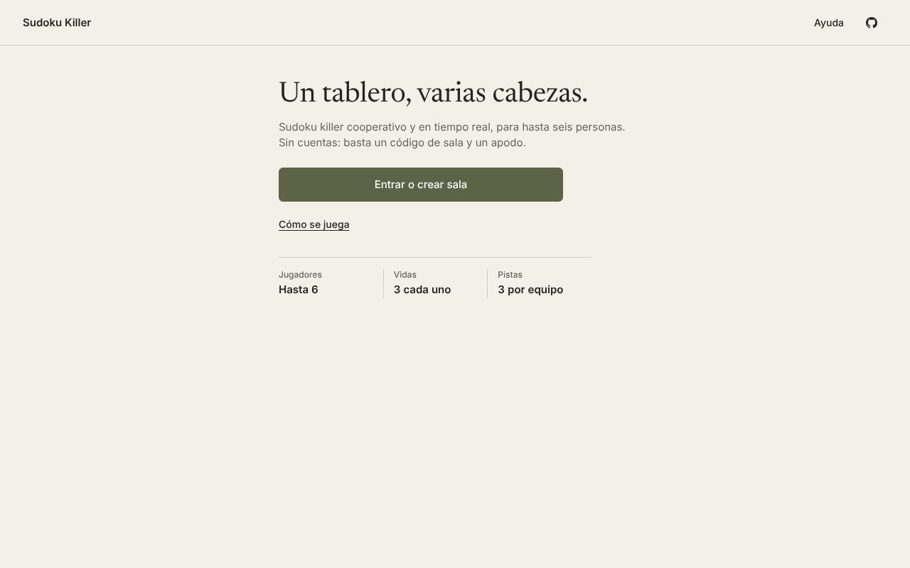
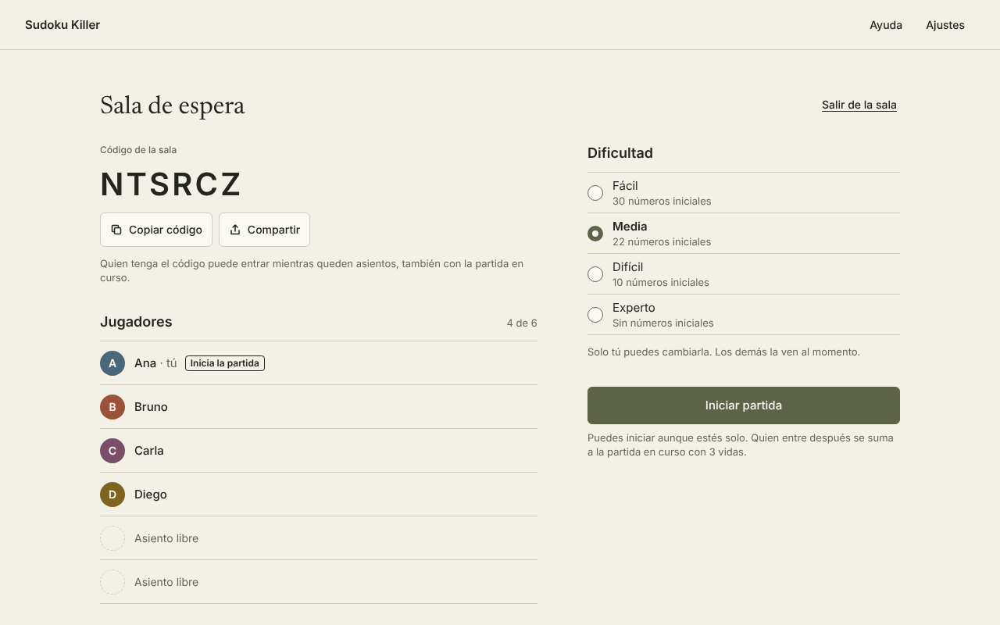
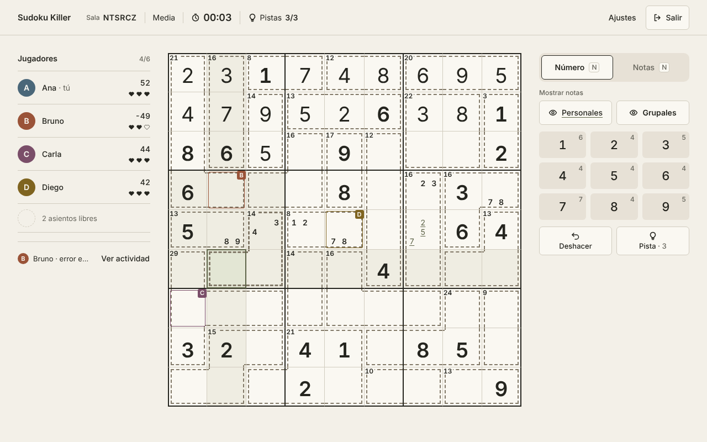
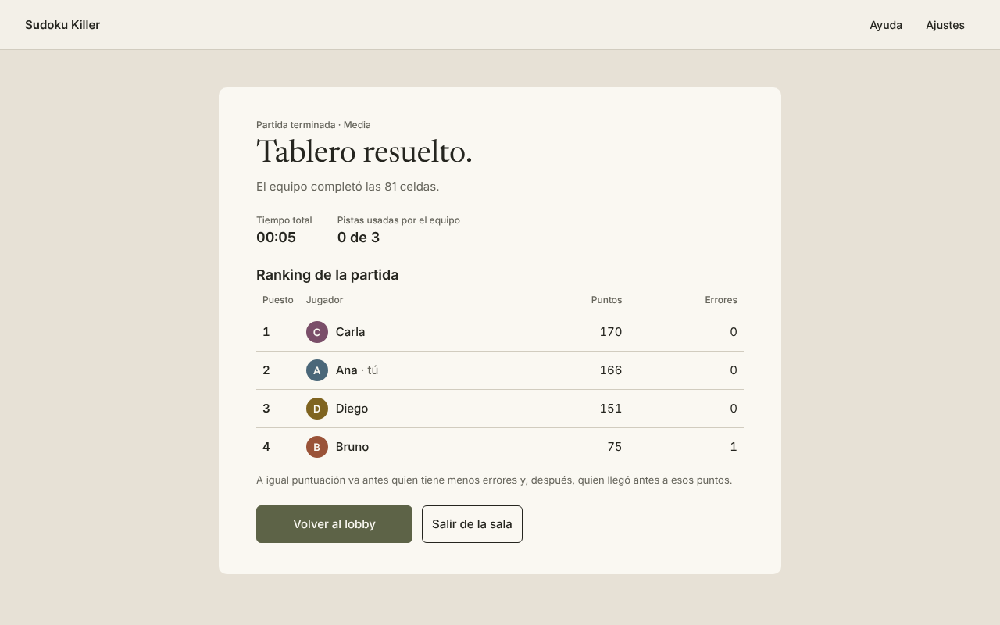
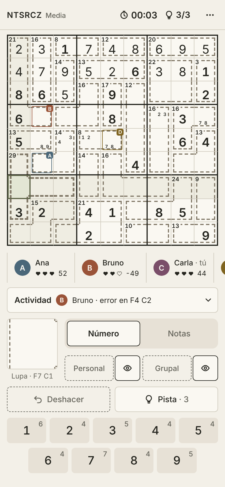
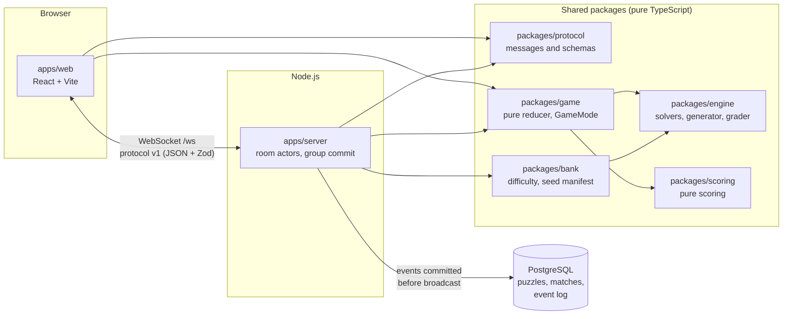

# Sudoku Killer

**English** · [Español](README.es.md)

Cooperative, real-time killer sudoku for up to 6 players. Join with a room code and a nickname — no accounts.

**Status: v1.0.0, complete.** A closed beta ran from 26 to 28 October 2026 with 15 players on Android, iPhone, Windows and Linux, with no player-facing bugs ([release notes](https://github.com/slesgmd/sudoku-killer/releases/tag/v1.0.0)).

[](https://github.com/slesgmd/sudoku-killer/actions/workflows/ci.yml)
[](LICENSE)
[](tsconfig.base.json)



- **Authoritative server.** The solution never leaves it; a leak inspector checks every outgoing message in the integration and end-to-end tests.
- **Real-time sync** over WebSocket with a versioned protocol validated by Zod on both ends; every move is committed to PostgreSQL before it is broadcast.
- **Reconnection without losing state.** Seat, lives, points and notes survive a dropped connection (2-minute grace period) and a server restart, rebuilt from the event log.
- **Tested in depth:** property-based tests, two independent solvers checked against each other, Playwright E2E against the real server, seeded chaos tests and a load test.

## Screenshots

| Home | Lobby |
|---|---|
|  |  |
| **Match in progress** | **Results** |
|  |  |

<details>
<summary>Mobile layout (390 px)</summary>



</details>

The visual prototype was built with Claude Design from original design decisions, documented in [docs/diseno.md](docs/diseno.md).

## Architecture



**A move, from click to broadcast.** The player clicks a cell and presses a digit. The client shows it as pending and sends a `cell.place` command with its own id. On the server, the message is rate-limited and validated with Zod, then queued in the room's actor, which processes one command at a time. The pure reducer in `packages/game` decides the outcome against the solution — which only the server holds — and the grader computes the cell's difficulty level for scoring. The resulting fact (`cell.solved` or `cell.mistake`) gets the next `seq` of the match and is written to PostgreSQL in a group commit; only after the commit does the room's outbox broadcast it, in order, to every player. Each client applies the same event with the same reducer and the same note clean-up, so all screens converge. If the connection drops, the client resends pending commands with the same id and the server answers from its idempotency cache instead of applying them twice.

## Technical decisions

| Problem | Decision | Rejected alternative | Why |
|---|---|---|---|
| Six players race on one board, and the answer must stay secret. | **Authoritative server** with its own protocol on `ws` ([ADR 0002](docs/adr/0002-tiempo-real.md)). | Colyseus, Socket.IO. | Colyseus syncs a state object, which duplicates the event log and makes leaking the solution easier; Socket.IO adds a protocol and a client the game does not need. |
| State, scores and reconnection must be rebuilt exactly, even after a restart. | **Append-only event log** per match, storing facts, committed before broadcasting ([ADR 0004](docs/adr/0004-registro-de-eventos.md)). | Storing the current state; async writes. | State snapshots lose the history needed to debug and recalibrate; async writes could lose events that clients have already seen. |
| A wrong "unique solution" check would ship broken puzzles. | **Two independent solvers** — constraint propagation with dom/wdeg search, and Dancing Links — that may not import each other, checked against each other and against brute force ([docs/motor.md](docs/motor.md)). | A single solver. | A bug shared by one code path goes unnoticed; two different algorithms agreeing is much stronger evidence. |
| Difficulty and scoring need to reflect how hard a cell is *for a person*. | **Human-technique grader**: 5 levels from singles to X-Wing and unit combinations, never guessing ([docs/motor.md](docs/motor.md), [docs/dificultad.md](docs/dificultad.md)). | Rating by number of givens or solver search effort. | Search effort measures the computer, not the player; the grader also gives each move a level, so a hard deduction is worth more than a forced single. |
| Scoring must reward real contribution and make guessing unprofitable, before any real games exist. | **Parameters validated by Monte Carlo simulation** with three kinds of bots on the full puzzle bank ([docs/puntuacion.md](docs/puntuacion.md)). | A speed-based formula. | With the same simulated games, the speed formula let the fast player win 66.3% of duels, against 57.4% with the chosen model. |
| Up to 6 people edit the same shared notes at once. | **Explicit add/remove operations ordered by the server**, optimistic client, undo only if the note is unchanged ([ADR 0005](docs/adr/0005-notas-grupales.md)). | CRDTs; last-writer-wins per cell; toggle. | There is always a central server, so a CRDT only adds metadata; last-writer-wins overwrites concurrent edits; two concurrent toggles cancel each other silently. |

All decisions are indexed in [docs/adr/](docs/adr/README.md).

## Testing and quality

- **Property-based tests with fast-check.** Every property runs through a helper that prints the seed on failure, and each failing seed is kept as a fixed regression case; a lint rule forbids calling `fc.assert` directly ([docs/motor.md](docs/motor.md#pruebas-aleatorias-y-semillas)).
- **Solver cross-checks.** On 1,000 random puzzles per size (4×4, 6×6 and 9×9), both solvers return the same solution count, and the same solution on the 189 unique ones. The pruned Dancing Links solver matched plain Dancing Links on all 4,307 puzzles compared. The 1,000-puzzle 9×9 corpus has uniqueness confirmed by both solvers ([docs/motor.md](docs/motor.md#solver-b-f4c)).
- **Grader soundness.** Over the corpus, 401,109 deductions, none contradicting the solution. The per-move level costs 9.2 ms at the p95 ([docs/motor.md](docs/motor.md#mediciones-3)).
- **Leak inspector.** Active by default in every integration and E2E test: it fails if a message carries the solution, a token, an unrevealed digit or another player's personal notes ([SPEC §8.3](docs/SPEC.md#83-inspector-de-filtración-t-311-t-291)). Every production build is also scanned for the simulator, the bank and any serialized solution.
- **E2E with Playwright** against the real server: six tabs play a full match, six simultaneous clicks on one cell give a single hit, a real disconnection loses nothing, the pages recover on their own from a server restart and from a database outage without showing unconfirmed moves, and any Content-Security-Policy violation fails the test ([apps/web/e2e/](apps/web/e2e/)).
- **Chaos tests** with a seed: real socket closes, a connection dropped right after a move and before its reply, and forced back-pressure; at the end every page must match the server and every move must appear exactly once in the log ([chaos.spec.ts](apps/web/e2e/chaos.spec.ts)).
- **Load test.** 50 rooms × 6 players (300 connections) on one instance: move latency p95 of 15.3 ms in the realistic scenario and 49.3 ms under stress (each connection paced at the rate limit of 20 commands per second), against a target of 150 ms. Measured on a 4-CPU container with the clients on the same machine, not on the hosting ([docs/carga.md](docs/carga.md)).
- **CI** ([ci.yml](.github/workflows/ci.yml)) on every push to `main` and every pull request: typecheck, ESLint with type information, Prettier, Vitest, build and E2E. Weekly workflows run the full corpus, new chaos seeds and the load test.

## Known limitations and future work

- **The free server sleeps** after 15 minutes without traffic and takes about a minute to wake up; the web app stays up and shows a "waking up the server" notice ([ADR 0007](docs/adr/0007-hosting.md)).
- **Scoring was calibrated by simulation** and kept unchanged after the closed beta. The fast player still wins about 57% of duels against an equally fast logical player, and scaling the mistake penalty by difficulty is listed as future work; the event log allows rescoring past matches without replaying them ([docs/puntuacion.md](docs/puntuacion.md#10-limitaciones-conocidas)).
- **Single instance.** Live rooms are kept in memory behind a `RoomStore` interface; scaling out would need a shared store and room affinity.
- **Load figures are local.** In production the server is watched through its metrics log line instead of a synthetic load on the free instance; the closed beta ran without performance problems, but saturation on a real slow network has not been tested ([docs/carga.md](docs/carga.md)).
- **Spanish-only interface**, with every string behind an i18n key; no dark theme yet.
- Ideas outside v1 — competitive mode, session ranking, chat, time-attack mode, persistent identity — are listed in [docs/IDEAS_FUTURAS.md](docs/IDEAS_FUTURAS.md).

## Running locally

**Requirements:** Node.js 24 (see `.node-version`), pnpm 12 (Corepack) and PostgreSQL (18 in development and CI). The E2E tests also need Playwright's Chromium.

```sh
pnpm install

# Local database: a role without privileges and its own database.
# Either run the helper (it writes DATABASE_URL to apps/server/.env; set PSQL to your psql path)…
pnpm --filter @sudoku-killer/server db:setup-local
# …or copy apps/server/.env.example to apps/server/.env and fill in DATABASE_URL.
pnpm --filter @sudoku-killer/server db:migrate
pnpm --filter @sudoku-killer/server bank:load   # regenerates and verifies the 2,000 puzzles (a few minutes)

pnpm dev   # server on 127.0.0.1:8080 and web on http://localhost:5173
```

To try the interface without a database, run `pnpm --filter @sudoku-killer/web dev` and open `http://localhost:5173/?sim=1&bot=3`: an in-browser simulated server with three bots (development only).

| Command | What it does |
|---|---|
| `pnpm check` | Typecheck, ESLint and Prettier |
| `pnpm test` | Unit, property and integration tests (Vitest; the server tests use in-process PGlite) |
| `pnpm build` | Compiles every package and builds the web app, then scans the bundle |
| `pnpm e2e` | Playwright against the real server (`pnpm exec playwright install chromium` in `apps/web` first) |
| `pnpm test:corpus` | Full corpus: 1,000 puzzles, the bank and the scoring validation (about 10 minutes) |

## Project structure

```
apps/
  server/      room server: WebSocket, room actors, PostgreSQL (Drizzle), bank, load and scoring scripts
  web/         React client, E2E tests, development-only simulated server and bots
packages/
  engine/      pure puzzle engine: model, two solvers, generator, grader
  protocol/    protocol v1 messages and Zod schemas (never the solution)
  game/        pure match reducer and GameMode modules
  scoring/     pure scoring and its versioned parameters
  bank/        difficulty mapping and seed regeneration
docs/          specification, ADRs, engine, scoring, load, security and design documents
design/        original interface prototype
tests/         repository-level tests (lint rules, deployment config)
```

## Deployment

The game runs privately for a closed group: the room server on a free Render web service, the static site on Render, and PostgreSQL on Neon, all described in [render.yaml](render.yaml). Every connection needs the group's access key (only its SHA-256 hash is configured on the server); the site sends a strict CSP and security headers; and weekly encrypted backups are checked with a restore drill ([ADR 0007](docs/adr/0007-hosting.md), [docs/seguridad.md](docs/seguridad.md)). This README does not link to the live instance.

## Documentation

The design documentation in [docs/](docs/) is written in Spanish: the [specification](docs/SPEC.md) with its verifiable rules and test cases, the [ADRs](docs/adr/README.md), the [engine](docs/motor.md), [difficulty](docs/dificultad.md), [scoring](docs/puntuacion.md), [load](docs/carga.md), [security](docs/seguridad.md) and [design](docs/diseno.md) documents. Code, identifiers and commit messages are in English.

## License and author

[MIT](LICENSE) © 2026 Sebastián Lescano · [github.com/slesgmd](https://github.com/slesgmd)
